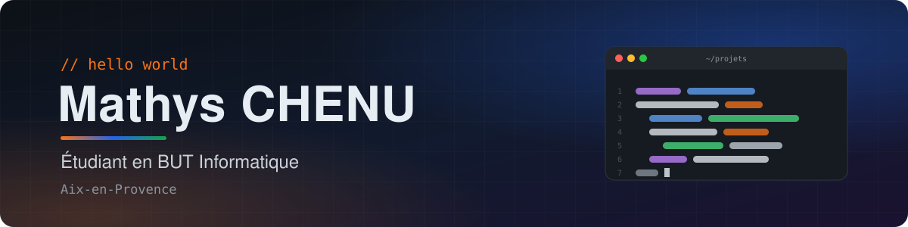

**Étudiant en BUT Informatique à Aix-en-Provence**

## Qui je suis

Je suis étudiant en **BUT Informatique** à l'IUT d'Aix-Marseille.

J'ai commencé le développement en **2021** avec **Python**, et je suis assez vite passé sur le **web**.

> Ce que je préfère, c'est vraiment la **création de sites web** : partir de rien, construire le design, et voir le résultat prendre forme directement dans le navigateur.

## MCH-Technologies

**[MCH-Technologies](https://mch-technologies.fr)**, c'est mon projet, déjà en ligne : je crée des **sites internet sur mesure**, pour les artisans, commerçants et petites entreprises.

Quelques sites déjà réalisés :

| Site | Type |
|:----:|:----:|
| [Yakha Sport Pernes](https://yakhasportpernes.fr) | Site vitrine pour une salle de sport |
| [StudyVerse](https://studyverse.fr) | Application web pour les étudiants |

## Ma formation

| Années          | Formation            | Où                                          |
|:---------------:|:--------------------:|:-------------------------------------------:|
| 2026 - en cours | **BUT Informatique** | IUT d'Aix-Marseille, site d'Aix-en-Provence |

## Les langages que j'utilise

Ceux que j'utilise le plus, ce sont **HTML**, **CSS**, **TypeScript** et **PHP**, parce que c'est ce qui me sert pour faire des sites. À côté, j'ai aussi utilisé le **C++** et le **C#** pour des applis, et **Python** pour des scripts, des serveurs et les cours.

## Côté serveur

Pour la partie serveur de mes sites, j'utilise surtout **Node.js** avec **Express**, et **npm** pour gérer les paquets. Ça me permet de faire tout le site en JavaScript/TypeScript, du front jusqu'au back.

## Mes outils

| Outil | Pourquoi je l'utilise |
|:-----:|-----------------------|
| **VS Code** | Mon éditeur de base, pour un peu tout |
| **JetBrains** | Quand je veux un IDE plus complet, ça dépend du langage |
| **Claude Pro** | Quand je bloque sur un bug ou pour comprendre un truc que je ne connais pas |
| **Git / GitHub** | Pour garder mes projets à jour et ne rien perdre |
| **MacBook Pro** | C'est sur lui que je bosse tous les jours |

<b>Pourquoi il n'y a pas mes projets ici ?</b>

 

La plupart de mes projets sont en **privé**, donc vous ne les verrez pas sur mon profil. Mais vous pouvez voir le résultat directement sur les sites que j'ai réalisés avec [MCH-Technologies](https://mch-technologies.fr).

## Me contacter

📍 Aix-en-Provence, France

